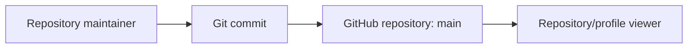

# Project Documentation: `mrudulpatil18`

## Table of Contents

- [Project Overview](#project-overview)
- [Repository Contents](#repository-contents)
- [Technology and Runtime](#technology-and-runtime)
- [Architecture and Data Flow](#architecture-and-data-flow)
- [Implemented Functionality](#implemented-functionality)
- [Testing, Deployment, and Operations](#testing-deployment-and-operations)
- [Engineering Assessment](#engineering-assessment)
- [Limitations and Future Improvements](#limitations-and-future-improvements)
- [Resume and Interview Preparation](#resume-and-interview-preparation)

## Project Overview

This repository is the GitHub account repository for `mrudulpatil18`. GitHub describes it as **“Personal Repository.”** It is not an application repository: the current default `main` branch contains no application source, dependency manifest, infrastructure definition, test suite, or executable entry point.

Accordingly, there is no repository-backed product problem statement, user workflow, API, database, or runtime behavior to document. The repository’s current purpose is best described as a personal GitHub profile/repository placeholder rather than a deployable software product.

### Product vision and target users

No product vision or target-user statement is encoded in the repository. The only project-level metadata is the GitHub repository description, “Personal Repository.” Any broader profile purpose, portfolio content, or external integrations would be outside the evidence in this checkout.

### Current implementation status

| Area | Status | Evidence |
|---|---|---|
| Application code | Not present | No source files are tracked |
| Documentation | Minimal/empty | `README.md` is empty in the current checkout |
| Configuration | Not present | No build, package, CI, container, or environment files |
| Tests | Not present | No test files or test configuration |
| Deployment | Not defined | No workflow, hosting, or infrastructure configuration |
| Public repository metadata | Present | GitHub description and `main` default branch |

## Repository Contents

The tracked working tree is intentionally minimal:

```text
mrudulpatil18/
└── README.md
```

`PROJECT_DOCUMENTATION.md` is this generated reference. Before this documentation change, `README.md` was the only tracked non-Git file and contained zero bytes.

### Important files

- `README.md` — repository landing-page file; currently empty.
- `PROJECT_DOCUMENTATION.md` — this generated documentation; it describes the repository as it exists and does not add product behavior.

There are no classes, functions, modules, API routes, data models, scripts, resource files, or entry points to trace.

## Technology and Runtime

No programming language or framework is declared by the repository. GitHub does not report a primary language for this repository. There are also no declared:

- Package managers or dependency manifests.
- Databases or persistence layers.
- External APIs or SDKs.
- Web servers, command-line interfaces, or background workers.
- CI/CD workflows.
- Dockerfiles or deployment manifests.
- Logging, metrics, tracing, or monitoring integrations.

The only infrastructure materially associated with the checkout is Git/GitHub repository hosting itself.

## Architecture and Data Flow

There is no executable architecture. The repository consists of static repository content, so the only observable flow is a user or maintainer editing files and GitHub serving them through the repository UI.



No runtime request processing, state management, persistence, asynchronous work, or inter-service communication is implemented.

## Implemented Functionality

The repository does not implement application features. The currently observable functionality is limited to:

1. Hosting a public Git repository under `mrudulpatil18`.
2. Providing an empty `README.md` landing-page file.
3. Exposing repository metadata through GitHub.

There are no meaningful application inputs or outputs. A Git commit is the effective input to the repository, and the resulting file tree is the output displayed by GitHub.

## Testing, Deployment, and Operations

No automated or manual test strategy is defined. There are no test commands, test fixtures, build commands, release steps, runtime environment variables, or deployment targets in the repository.

GitHub repository hosting supplies version control and public browsing, but the repository contains no evidence of GitHub Actions, a static-site build, a package release, or an application deployment.

## Engineering Assessment

The principal engineering characteristic is intentionally low complexity: there is no application surface to maintain. This makes the repository easy to understand and unlikely to have code-level runtime failure modes, but it also means no product or engineering capability can be evaluated from this repository alone.

No performance, scalability, security, or reliability claims are supportable beyond standard GitHub repository access controls. No secrets or credentials are present in the tracked files.

## Limitations and Future Improvements

Potential improvements depend on the repository’s intended role:

- If this is a profile repository, add a README describing the owner’s focus, selected projects, technologies, and contact or portfolio links.
- If it is intended to become a software project, add a problem statement, source tree, dependency manifest, reproducible setup instructions, tests, and deployment documentation.
- Add CI validation once executable content exists.
- Add a license if the repository is intended for reuse.

These are recommendations, not implemented plans. The repository does not currently state which direction is intended.

## Resume and Interview Preparation

### Resume bullet candidates

Because this repository contains no application implementation, strong technical resume claims cannot be responsibly derived from it. The only accurate candidates are repository-management statements:

- Maintained a public GitHub repository used as a personal project/profile landing point.
- Structured a Git repository for future project documentation and source publication.

These should not be presented as evidence of building a software system.

### Technologies demonstrated

- Git repository organization.
- GitHub repository hosting.

No programming language, framework, database, API, or infrastructure technology is demonstrated by the current files.

### Interview questions and answer outlines

1. **What does this repository do?**  
   It is a personal repository placeholder with no executable application.
2. **What is the entry point?**  
   None exists in the tracked source.
3. **What dependencies does it use?**  
   None are declared.
4. **How is it tested?**  
   No test suite or test command is present.
5. **How is it deployed?**  
   No deployment configuration is present; GitHub hosts the repository contents.
6. **What data store does it use?**  
   None.
7. **What API does it expose?**  
   None.
8. **What are the main scalability concerns?**  
   No runtime system exists; repository hosting concerns are delegated to GitHub.
9. **What security controls are implemented?**  
   No application security layer is implemented; no secrets are tracked.
10. **What would you add next?**  
    First clarify whether the repository is a profile landing page or a software project, then add only the corresponding minimal structure.

### Project explanation

**30 seconds:** This is a public personal GitHub repository rather than an executable project. Its current `main` branch contains only an empty README, with no source code, dependencies, tests, APIs, or deployment configuration.

**2 minutes:** The repository is a minimal GitHub-hosted personal repository. The current checkout has no application architecture or runtime behavior to trace: there are no language files, build manifests, data models, API endpoints, infrastructure definitions, or test suites. The repository metadata identifies it as “Personal Repository,” and the empty README is the only pre-existing tracked content. Any technical project claims would need to come from other repositories or future commits, not this repository.
